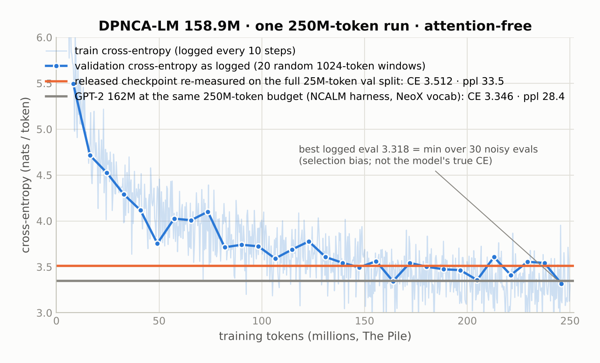
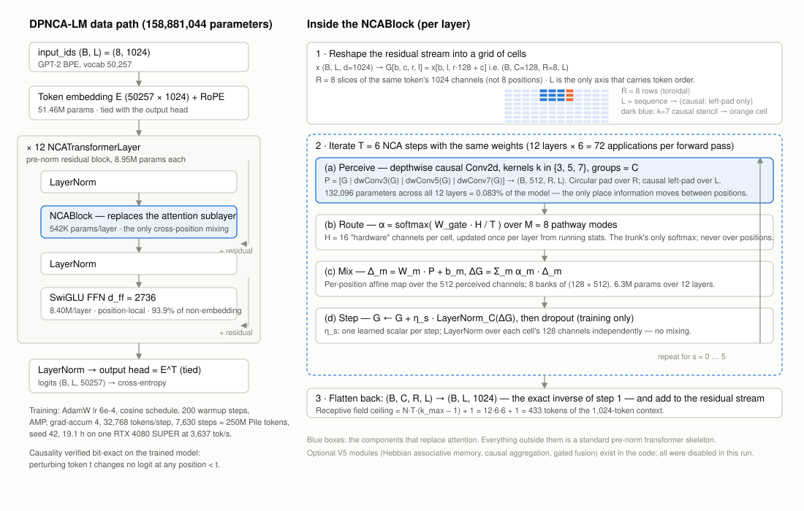
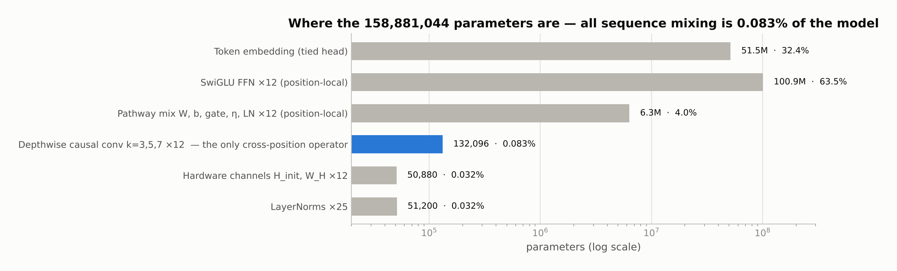

# DPNCA-LM — an attention-free language model built on an iterative neural cellular automaton

A 158.9M-parameter language model in which the attention sublayer of a transformer is replaced by six steps of a causal 2D neural cellular automaton (NCA). It was trained once, end to end, on 250M tokens of The Pile on a single consumer GPU. It is a real language model and it loses to a same-size transformer at the same token budget by 15–18%. This repository contains the code, the full training log, the released weights, and the scripts that let you check every number below yourself.

**Result in one line:** every bit of information that moves between token positions in this model passes through **132,096 depthwise-convolution parameters — 0.083% of the model** — reused 72 times per forward pass, and that is enough to reach a validation cross-entropy of 3.51 nats/token (perplexity 33.5) on The Pile; a GPT-2-style transformer of the same size and token budget reaches 3.35 (perplexity 28.4).



## Headline numbers

| Quantity | Value | How it was measured |
|---|---|---|
| Parameters | **158,881,044** | `scripts/verify_params.py`; matches the training log line for line |
| Training data | 250,000,000 GPT-2-BPE tokens of The Pile (uncopyrighted subset), 90/10 split by position | `dpnca/data/dataset.py` |
| Training run | 7,630 steps × 32,768 tokens, seed 42, 19.1 h, 3,637 tok/s, one RTX 4080 SUPER | `runs/dpnca_160m_pile_250m/training.log` (complete, 763 step lines, no gaps) |
| Validation CE, full split | **3.512 nats/token → perplexity 33.5** | released checkpoint evaluated over 80 deterministic 1024-token windows spanning the full 25M-token validation split with `exp(mean CE)` |
| Validation CE as logged | best 3.318 at step 7,500; mean of the last 15 evals 3.488 | 20 random windows per eval; the minimum over 30 noisy evals is an optimistic statistic and should not be quoted as the model's perplexity |
| Same-size transformer, same token budget | CE 3.346 → perplexity 28.4 | GPT-2-style 162.3M model trained on 250M Pile tokens in the [NCALM harness](https://github.com/Peterpetu/NCALM); not protocol-identical (GPT-NeoX tokenizer, vocab 50,304 vs 50,257 here), but decisive |
| Attention parameters | **0** | the released checkpoint's 471 tensors match the attention-free module list exactly, `strict=True` |
| Causality | exact | perturbing the token at position *t* changes logits at every position < *t* by **0.000e+00** on the trained model |
| Receptive field | 433 tokens (structural ceiling) of the 1,024-token context | `N·T·(k_max−1)+1 = 12·6·6+1`; confirmed by autograd (input gradient is non-zero over exactly 433 positions) |

## What the model is



The skeleton is a standard 12-layer pre-norm residual stack with SwiGLU feed-forward blocks and a weight-tied GPT-2 embedding. The attention sublayer is replaced by an `NCABlock`:

1. **Reshape.** The 1,024-channel residual stream of each token is folded into a grid of 8 rows × 128 channels. The row axis indexes slices of the *same* token; the sequence axis is the only axis that carries token order.
2. **Iterate six NCA steps with shared weights.** Each step is (a) *perceive* — depthwise causal 2D convolutions with kernels 3, 5 and 7 (circular over rows, left-padded over the sequence); (b) *route* — a softmax over 8 pathway modes, computed from 16 per-cell "hardware" channels; (c) *mix* — a per-position affine map of the perceived features through the 8 pathway banks, weighted by the routing; (d) *step* — a gated residual update with a per-step learned scalar and a per-cell LayerNorm.
3. **Flatten** back to `(B, L, 1024)` and add to the residual stream.

The depthwise convolutions in step (a) are the *only* cross-position operator in the network. The routing softmax is over modes, never over positions; the mix, the LayerNorms and the feed-forward blocks are all strictly position-local.



For comparison, a GPT-2-class transformer spends roughly a third of its non-embedding parameters on the Q/K/V/O projections; this model spends 0.12% of its non-embedding parameters on sequence mixing — about 270× less — and reuses them 72 times.

## What the run actually found

* **It is a language model, not a bag of positions.** The gap to the transformer is 15–18%, not an order of magnitude. Fully attention-free NCA variants in the companion [NCALM](https://github.com/Peterpetu/NCALM) study, trained on the same data under a matched protocol, landed at perplexities of 369–2,425. This is the only attention-free architecture I have trained that is within striking distance of a transformer.
* **It is undertrained by design of the budget.** 1.57 tokens per parameter is roughly 13× below the Chinchilla-optimal ratio. The run is schedule-complete, not converged.
* **The bounded receptive field is a structural property, not a bug.** With a fixed-radius local rule and no global operator, reach grows additively: `N·T·(k_max−1)+1`. No hyperparameter fixes this; the attempt to fix it (the V5 modules in this package) had to import an L×L score matrix — attention — and was not pursued here. The honest control for this model is a same-size transformer with a hard 433-token sliding window at the same token budget, which I have not run.
* **The auxiliary loss terms did not do what the plan said.** The package adds three regularisers to the cross-entropy. The two that act on routing — pathway balance (`λ=0.01`) and Helmholtz routing entropy (`λ=0.01` in the recorded config) — are computed from routing weights that are detached before accumulation, so their gradients are identically zero by construction; the logged pathway-balance value nevertheless rose from 0.000 to 2.944, meaning the router specialised under cross-entropy pressure alone. The hardware-smoothness term (`λ=0.1`) was live but pathological: its target is detached while 5% of the live state leaks into the prediction, a positive-feedback loop that grew the term 20.9× to 67.3% of the final objective. Cross-entropy is cleanly separable from all three, so the reported CE stands.
* **The logged validation numbers are noisier and more optimistic than they look.** Each eval used 20 unseeded random windows (0.66% of the split) and averaged per-batch perplexities. The full-split re-measurement above is the number to quote.

## Verify it yourself

The released weights are the asset of GitHub Release [`v1.0`](https://github.com/Peterpetu/DPNCA-LM/releases/tag/v1.0) (fp16, 318 MB, 471 tensors; the tied output head is omitted and re-tied at load):

```
dpnca_160m_best_fp16.safetensors
sha256  1538dd9c23872aba2179ffa829a1f493b320d9bfdb83f7a4d24ba811652b8fe7
```

```bash
pip install -e .                       # torch, numpy, tiktoken, safetensors
python scripts/verify_params.py        # reproduces 158,881,044 from the config
python scripts/verify_checkpoint.py --weights dpnca_160m_best_fp16.safetensors \
    --text some_english.txt --prompt "The city council met on Tuesday evening to discuss"
```

`verify_checkpoint.py` instantiates `DPNCA_160M`, loads the file with `strict=True`, runs the causality perturbation test, prints the receptive-field ceiling, and optionally reports cross-entropy on any UTF-8 text and a greedy continuation. Expected output for the first four checks:

```
[1] parameters: 158,881,044 (expected 158,881,044) -> OK
[2] strict load: OK (472 tensors incl. re-tied output head)
[3] causality: max |delta logit| at positions < t = 0.000e+00 -> OK
[4] receptive field ceiling: 12*6*(7-1)+1 = 433 tokens (context 1024)
```

To reproduce the full-validation number you need the token cache (see below), then:

```bash
python scripts/eval_pile_val.py --weights dpnca_160m_best_fp16.safetensors \
    --cache data_cache/pile_250M_gpt2.pt --windows 80      # 0 = every window in the split
```

## Reproduce the training run

```bash
# 1. Build the token cache: 250M GPT-2-BPE tokens streamed from monology/pile-uncopyrighted
python -c "from dpnca.data.tokenizer import GPT2Tokenizer; from dpnca.data.dataset import CorpusData; \
           CorpusData('pile', GPT2Tokenizer(), max_tokens=250_000_000)"
# 2. Train (19 h on a 16 GB RTX 4080 SUPER)
python scripts/train.py --config 160m --profile pile_250m --dataset pile --max-tokens 250000000 --seed 42
```

The run configuration recorded in the checkpoint is in `runs/dpnca_160m_pile_250m/config.json`; the per-step and per-eval metrics parsed from the log are in `train_metrics.csv` and `eval_metrics.csv` next to it.

## What I would run next

Three experiments, each a few GPU-hours, would turn this single run into an interpretable comparison:

1. a parameter-, data- and step-matched GPT-2 on the *same* token cache and tokenizer (the current comparison crosses tokenizers);
2. the same transformer with a hard 433-token sliding window, to separate "attention beats a local NCA rule" from "long context beats short context";
3. an `M=1` ablation of the 8-way pathway router, which decides whether the hardware-gated mixture of update rules is a mechanism or decoration.

## Repository layout

```
dpnca/              model code (config, embedding + RoPE, perception, pathway update, NCA layer, FFN, model, training)
dpnca/data/         GPT-2 BPE tokenizer wrapper and the Pile / TinyStories token cache builder
scripts/            train.py · verify_params.py · verify_checkpoint.py · eval_pile_val.py
tests/              107 unit tests (`python -m pytest tests -q`), including mathematical-identity and causality tests
runs/dpnca_160m_pile_250m/   the complete training log, parsed metrics, and the run config
figures/            the figures in this README (SVG + PNG)
```

The optional V5 modules (`memory.py`, `aggregation.py`, gated fusion) are part of the package and tested, but every V5 flag was `False` in the reported run; the checkpoint contains no parameters from them.

## License and citation

The code and any released weights are licensed under the Apache License 2.0 (`LICENSE`); the documentation, figures and data under CC BY 4.0. Both require attribution: a copy or derivative of the code keeps the `NOTICE` file, and any reuse of the text, figures or data credits the author and links to the source.

If you use this work, build on it, or report results obtained with it, cite it:

> Lahtinen, P. (2026). *DPNCA-LM: an attention-free language model built on an iterative neural cellular automaton.* https://github.com/Peterpetu/DPNCA-LM

```bibtex
@misc{lahtinen2026dpnca,
  author = {Lahtinen, Peter},
  title  = {DPNCA-LM: an attention-free language model built on an iterative neural cellular automaton},
  year   = {2026},
  url    = {https://github.com/Peterpetu/DPNCA-LM}
}
```

`CITATION.cff` carries the same reference for GitHub's "Cite this repository" button and for reference managers.
